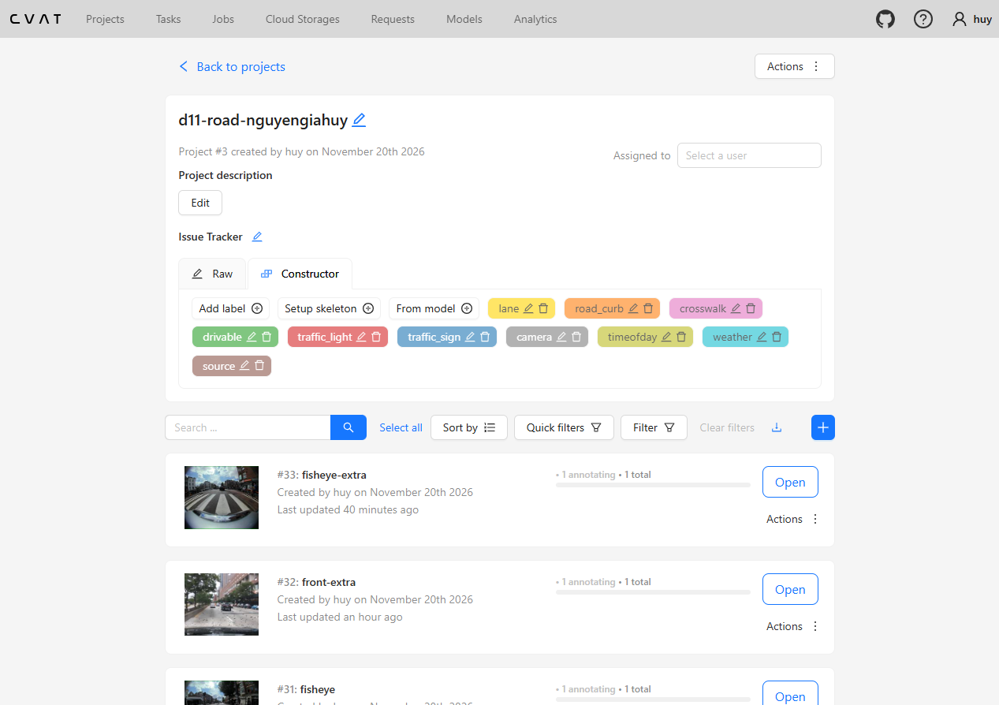
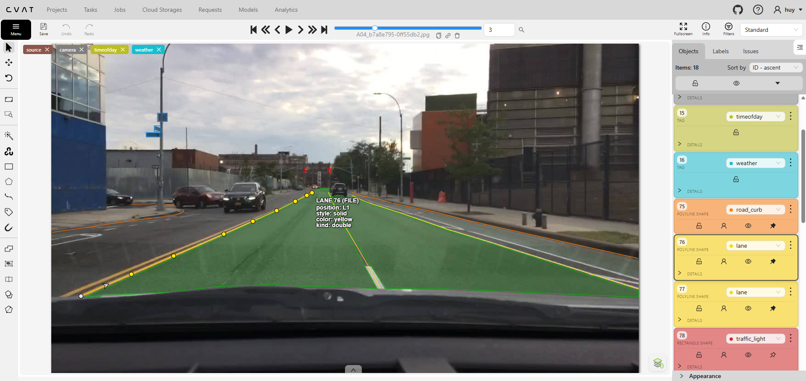
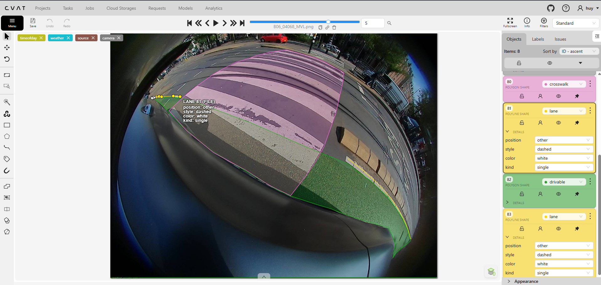
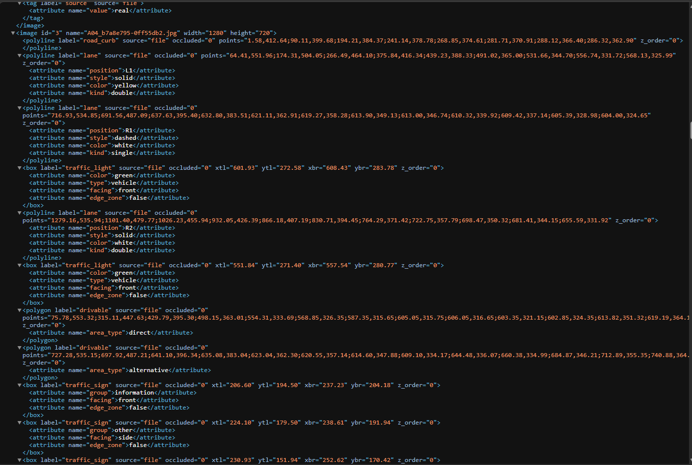

# Báo cáo cá nhân — Ngày 11
Họ tên: Nguyễn Gia Huy  
Mã học viên: 2A202603215  
Phiên bản CVAT (Help → About): 2.74.1  
Guideline: Road v1.0  
Lần nộp (`revision` trong manifest): 1  
Thời điểm export (ngày giờ trên CVAT): 21/11/2026, 01:35:17 (giờ Việt Nam, UTC+7; lần export cuối của task fisheye-extra, theo `meta/dumped` trong XML).  
Số lần nộp lại sau Rework: 0; các lỗi được sửa trong quá trình kiểm tra và chỉnh nhãn trước lần nộp đầu tiên.  

## 1. Kiểm project
| Mục | Đúng như guideline Road v1.0? | Ghi chú |
| --- | --- | --- |
| 6 label, đúng kiểu | Đúng theo XML export | lane, road_curb dùng polyline; crosswalk, drivable dùng polygon; traffic_light, traffic_sign dùng rectangle. |
| Thuộc tính và giá trị | Đúng về tên và giá trị hợp lệ | Em kiểm tra theo Road v1.0. Các thuộc tính đọc được và nằm trong danh sách cho phép; các ca chưa rõ về cách gán được ghi ở mục 3. |
| 4 tag ảnh | Đủ | Cả 28 ảnh có camera, timeofday, weather, source; tổng cộng 112 tag. |
Cách kết thúc polyline trên bản CVAT này: Chọn Polyline → label cần gán → Shape, bấm các điểm từ gần ra xa rồi nhấn N để kết thúc.  
Cách đặt tag ảnh trên bản CVAT này: Dùng công cụ Tag, lần lượt thêm camera, timeofday, weather, source rồi mở Details để chọn value cho từng tag.  

## 2. Số lượng đã gán
| Task | Ảnh | lane | road_curb | crosswalk | drivable | traffic_light | traffic_sign |
| --- | ---: | ---: | ---: | ---: | ---: | ---: | ---: |
| front | 12 | 30 | 21 | 6 | 25 | 39 | 48 |
| front-extra (đã làm 4 / 4) | 4 | 10 | 2 | 2 | 8 | 12 | 17 |
| fisheye | 8 | 8 | 15 | 8 | 11 | 10 | 10 |
| fisheye-extra (đã làm 4 / 4) | 4 | 0 | 2 | 3 | 2 | 1 | 0 |

Em đã làm 20 ảnh bắt buộc và 8 ảnh thêm, tổng cộng 28 ảnh với 290 shape và 112 tag. Số liệu trong bảng được đếm từ các file export hiện tại, không tính tag vào số shape. B11 không có shape vì chỉ thấy vạch ô đỗ và vùng kẻ chéo; ảnh vẫn có đủ bốn tag.

Hiện cả bốn job front, fisheye, front-extra và fisheye-extra đều ở trạng thái completed. Sau khi hoàn tất các task extra, em export lại rồi gộp A01–A16 vào `nguyengiahuy-front.zip` và B01–B12 vào `nguyengiahuy-fisheye.zip`. Hai ZIP không kèm ảnh và khớp SHA-256 trong manifest revision 1. Bản trước khi gộp được giữ cục bộ trong `../r1/before-extra/`. Phần ảnh thêm chưa có kết quả chấm điểm của coach.

## 3. Bảng ca khó
| Ảnh | Nhãn | Phân vân giữa | Đã chọn | Lý do |
| --- | --- | --- | --- | --- |
| A13 | lane, weather | Vạch mờ do mưa hay kéo dài theo phỏng đoán | weather=rain; vẽ theo phần sơn còn nhận biết được | Giọt nước và phản chiếu làm vạch khó nhìn. Em tránh lấy các vệt này làm tâm làn. |
| A14 | lane R1 | Vạch phía phải bị che hay không có vạch rõ | Không thêm R1 | Không có vạch sơn R1 nhìn thấy ở phía phải taxi; em không vẽ theo phỏng đoán. |
| A15 | lane, traffic_sign | Vạch nhạt với vết vá; biển chính với biển phụ | Polyline theo tâm sơn; biển phụ có box riêng | Em chọn weather=overcast và phân biệt biển công trường với biển phụ đi kèm. |
| A16 | lane R1, drivable | Vạch bị xe che; có nên khoét vùng lái quanh xe | R1 bật occluded; drivable không khoét quanh xe | Em nối qua đoạn che ngắn và giữ vùng lái theo mặt đường có thể đi được khi không có xe. |
| B09 | lane, traffic_light | Vạch qua đường/ray với vạch làn; màu đèn không rõ | Không có lane; một traffic_light với color=unknown | Em chưa xác định được màu đèn nên không đoán màu. Các dải qua đường và ray không được gán thành lane. |
| B10 | crosswalk | Gán từng dải gạch trắng hay cả vùng qua đường | Một polygon cho cả vùng crosswalk | Em đi viền theo cung cong trên ảnh và dừng ở mép thân xe. |
| B11 | lane | Vạch ô đỗ, vùng kẻ chéo hay vạch làn | Không vẽ lane; giữ đủ bốn tag | Đây là vạch ô đỗ người khuyết tật và vùng kẻ chéo, thuộc phần không gán lane theo guideline. Cần coach xác nhận cách tính ảnh thêm này. |
| B12 | drivable, crosswalk | Mặt đường với thân xe; ranh giới dải xe đạp | drivable có area_type=direct; crosswalk là polygon riêng | Em cắt vùng lái theo mép thân xe. Ranh với dải xe đạp chưa rõ nên phần direct cần coach xem lại. |
| A05 | lane, QC1-02 | Không thấy vạch sơn hay tự vẽ ranh làn | Không thêm L1/R1 | Không có vạch sơn nhìn thấy ở bên trái và bên phải để gán L1/R1. Hai bên có xe đỗ và lề đường nên em không tự vẽ ranh làn. |
| A06 | lane, QC1-02 | Vạch R1 với mép lề phía phải | Không thêm R1 | Không có vạch sơn R1 nhìn thấy ở phía phải. Em không lấy mép lề làm lane. |

## 4. Phiếu QC 1 nhận được
Bạn kiểm lô của tôi: Nguyễn Hải Đăng.  Quyết định nhận được: Hold, theo phiếu QC `nguyenhaidang-qc1-for-nguyengiahuy.md`.  
| Mã lỗi | Số lỗi | Đồng ý? | Đã sửa? |
| --- | ---: | --- | --- |
| QC1-03 | 0 | Có | Đã sửa 1 lỗi cũ: đổi position của lane B06 từ L1 sang other. |
| QC1-05 | 0 | Có | Đã sửa 3 lỗi cũ: bỏ polyline trùng ở A04 và nối các đoạn R1 ở A08. |
| QC1-11 | 0 | Có | Đã sửa 6 lỗi cũ: bật edge_zone cho các đèn, biển ở vùng rìa trong B02, B03, B04. |
| QC1-02 | 0 | Có, theo nhận xét của anh Đăng | A05 không có vạch sơn L1/R1 nhìn thấy; A06 và A14 không có vạch R1 nhìn thấy. Không vẽ thêm theo phỏng đoán. |

Trong phiếu QC do anh Nguyễn Hải Đăng kiểm bài của em, mẫu kiểm gồm 6 ảnh A04, A08, B02, B03, B04, B06, với 90 shape và 24 tag, tổng cộng 114 nhãn. Cột “Số lỗi” ghi số lỗi còn lại sau sửa, hiện là 0. Phiếu vẫn giữ 10 lỗi cũ đã sửa để ghi nhận quá trình chỉnh nhãn: 1 lỗi nặng và 9 lỗi chính.

Kiểm tra lại bằng lint, sáu ảnh mẫu không còn cảnh báo. Toàn bộ 28 ảnh vẫn có bốn cảnh báo QC1-02: A05 thiếu L1/R1, A06 và A14 thiếu R1 theo kiểm tra tự động. Anh Đăng không tính các trường hợp này là lỗi bỏ sót vì không có vạch sơn nhìn thấy để gán. Phiếu giữ Hold để chờ coach xác nhận ngoại lệ và quy ước L/R ở camera sau; chưa có kết quả đối chiếu với GT.

## 5. Kiểm file export
| File | Mở lại được? | Số shape ảnh 1 (job / file) | Số shape ảnh 2 (job / file) | Tag camera có trong XML? |
| --- | --- | --- | --- | --- |
| nguyengiahuy-front-extra.zip | Có, đọc được XML trong ZIP; không kèm ảnh | 7 / 7 | 11 / 11 | Có, 4/4 ảnh |
| nguyengiahuy-fisheye-extra.zip | Có, đọc được XML trong ZIP; không kèm ảnh | 5 / 5 | 1 / 1 | Có, 4/4 ảnh |
| nguyengiahuy-front.zip | Có, đọc được XML trong ZIP; không kèm ảnh | 8 / 8 | 7 / 7 | Có, 16/16 ảnh |
| nguyengiahuy-fisheye.zip | Có, đọc được XML trong ZIP; không kèm ảnh | 6 / 6 | 10 / 10 | Có, 12/12 ảnh |

Trong cột job/file, số trước dấu “/” được lấy từ XML export gốc của từng job, số sau là số đếm trong ZIP đang kiểm tra. Đây là đối chiếu dữ liệu export, chưa phải số đếm trực tiếp trên giao diện. Shape không bao gồm bốn tag của ảnh.

Em giữ bản export gốc của hai task extra tại `../r1/task-exports/` để đối chiếu. Hai tệp extra đã được gộp vào ZIP chính và không thuộc năm tệp nộp riêng.

Hai ảnh đối chiếu lần lượt là A01/A02 cho front, B01/B02 cho fisheye, A13/A14 cho front-extra và B09/B10 cho fisheye-extra. Khi mở trên CVAT, cần kiểm lại các số này; nếu Items gồm cả tag thì trừ bốn tag trước khi so sánh. Ví dụ A04 có 14 shape và 4 tag, tức 18 đối tượng nếu giao diện hiển thị chung.

## 6. Ảnh chụp màn hình
Các ảnh dưới đây được chụp từ project CVAT và file XML export của bài.

1. Tab Labels của project.

   Project `d11-road-nguyengiahuy` có đủ sáu label hình và bốn tag ảnh.

   

2. Một ảnh camera trước đã gán đủ (làn, vùng lái, đèn/biển).

   Ảnh A04 có lane, drivable, road_curb và các box đèn, biển. Lane đang chọn có position=L1, style=solid, color=yellow, kind=double. Giao diện hiển thị 18 đối tượng, khớp 14 shape và bốn tag.

   

3. Một ảnh fisheye đã gán, phóng to đoạn polyline cong.

   Ở B06, đường lane bên phải đi theo cung cong của ảnh fisheye. Cả hai lane có position=other vì đây là camera bên trái.

   

4. Một đoạn XML có `<polyline label="lane">`.

   Đoạn XML của A04 thể hiện tọa độ points và các thuộc tính position, style, color, kind của lane.

   

## 7. Tự đánh giá
Lỗi bạn mắc nhiều nhất hôm nay (theo mã QC1-xx), và cách tránh ở Ngày 20:  
Theo phiếu QC của anh Đăng, trong 10 lỗi đã ghi, em gặp QC1-11 nhiều nhất: sáu trường hợp chưa bật edge_zone cho đèn hoặc biển ở vùng rìa fisheye. Ban đầu em tập trung vào hình và thuộc tính chính nên bỏ sót cờ này. Lần sau, em sẽ kiểm riêng các box gần mép ảnh, xét vị trí tâm hộp theo ngưỡng 80% bán kính rồi rà lại bằng lint trước khi export.

Nhãn của bạn đi vào model ở đâu? Chọn một lỗi đã sửa và nói nó làm model học sai thế nào:  
Tọa độ và thuộc tính annotation là nhãn đích cho mô hình học nhận biết làn, vùng lái, đèn và biển. Ví dụ, em từng đặt L1 cho lane ở camera trái B06. Nếu dùng nhãn này để huấn luyện, mô hình có thể học nhầm vị trí của vạch so với làn xe. Em đã đổi thành other theo guideline. Qua lỗi này, em thấy vẽ đúng hình vẫn chưa đủ; thuộc tính cũng phải đúng thì dữ liệu mới dùng được.

## 8. (Tùy chọn, buffer) Từ polyline đến đích row-anchor
Em không thực hiện phần buffer trong lần nộp này nên chưa có số liệu tính và so sánh.

| y | 720 | 680 | 640 | 600 | 560 |
| --- | ---: | ---: | ---: | ---: | ---: |
| x của chúng tôi | — | — | — | — | — |
| x của bạn kia | — | — | — | — | — |

Trả lời 3 câu:

1. Năm số x đó chính là đích mà một model row-anchor học cho vạch này. Nếu bạn dừng polyline sớm 40 px, hàng nào đổi thành "không có làn"?
2. So với bạn được kiểm (cùng ảnh): ở hàng 720 và hàng 560, hai bạn lệch nhau bao nhiêu pixel? Lệch ở hàng nào ảnh hưởng LKA nhiều hơn (slide 25)?
3. Nếu polyline vẽ từ xa về gần (ngược quy tắc 2), cách tính trên có đổi không? Script nào sẽ gặp khó?
